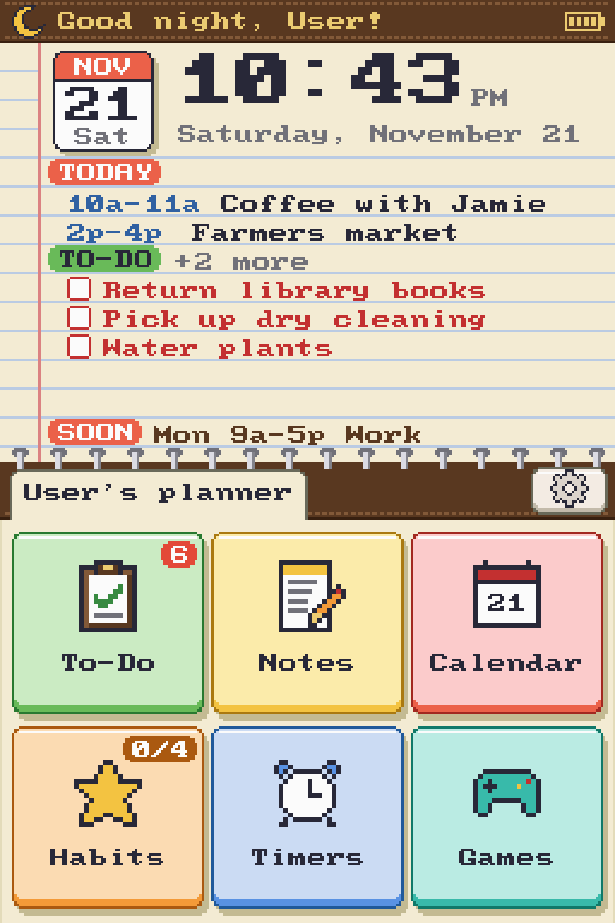
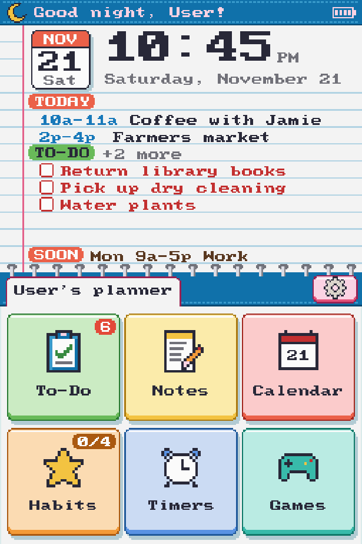
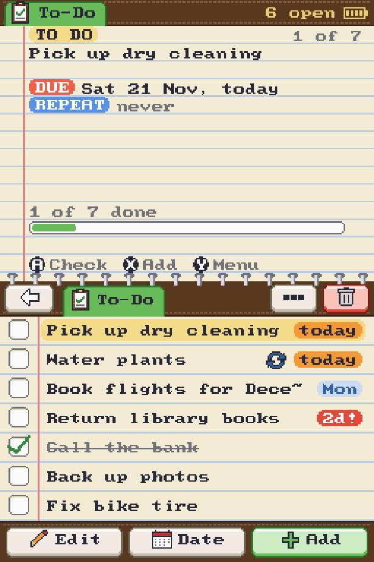
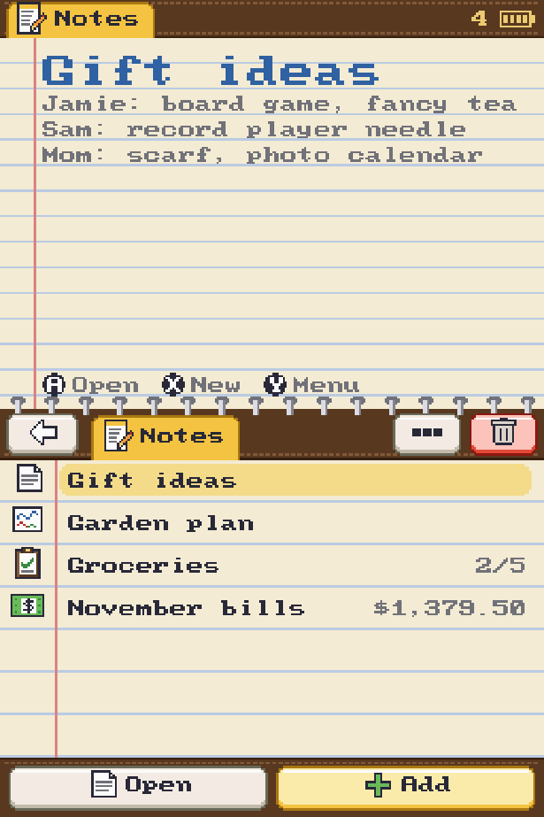
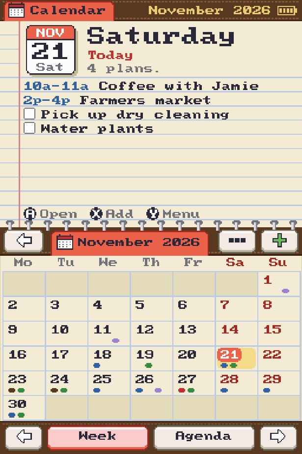
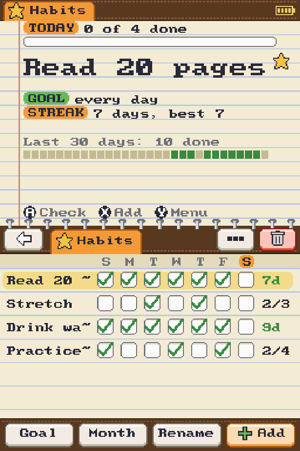
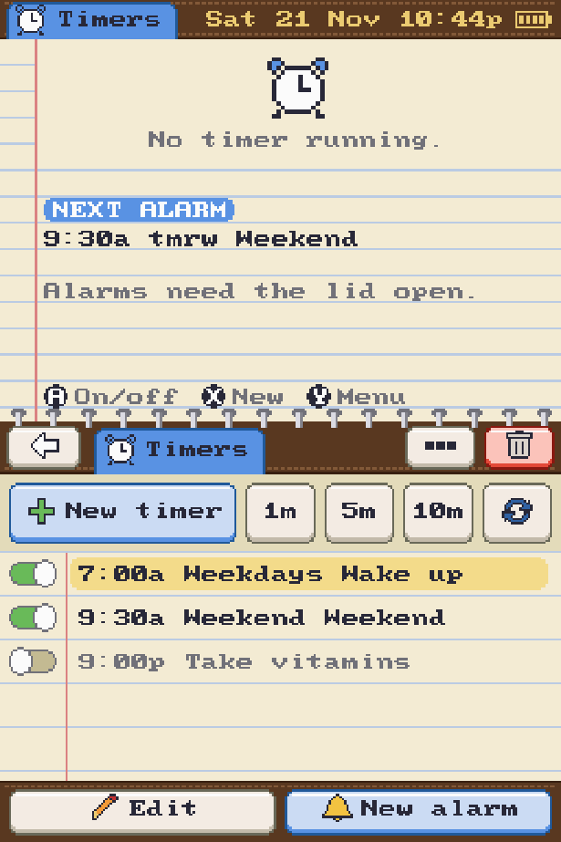
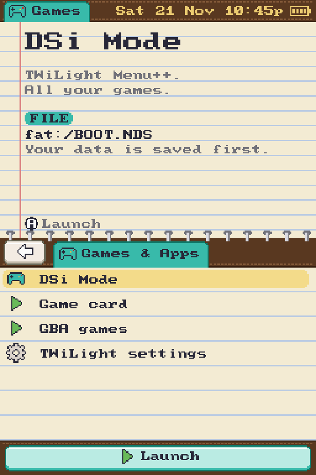

# DSi PDA

A pocket planner for the Nintendo DSi. It turns the console into a little
PDA: to-do list, notes, checklists, bills and sketches, a calendar with
birthdays, work shifts and an agenda, a habit tracker, and countdown timers
and alarms. Everything is touched directly on the bottom screen, and it
looks like a spiral-bound paper planner with the hinge as the binding.

It can also be your DSi's home screen: set Unlaunch to boot it on power-on,
and its **Games** tile hands off to TWiLight Menu++ whenever you want to play.

<p align="center">
  
  
</p>

| To-Do | Notes | Calendar |
|:---:|:---:|:---:|
|  |  |  |
| **Habits** | **Timers** | **Games & Apps** |
|  |  |  |

*Screenshots from melonDS with demo data.*

## Features

- **To-Do** with due dates, repeats (every N days, weeks, months, years) and
  quick typing (`Dentist due:fri`).
- **Notes**: plain notes, checklists, a tiny bills ledger that totals itself,
  and sketches with four inks.
- **Calendar**: month and week views, timed and all-day events, multi-day
  trips, birthdays and anniversaries ("Sam turns 30"), work shifts, US
  holidays, and an agenda for the next 30 days.
- **Habits**: daily or N-times-a-week goals, streaks, and a month view.
- **Timers**: countdowns with one-tap 1/5/10 minute keys, alarms with days
  of the week, snooze, and a "missed" notice for alarms that came due while
  the console slept.
- **Games & Apps**: launches TWiLight Menu++, the game card, GBARunner2, or
  any `.nds` file; a launched app that exits returns to TWiLight Menu++.
- Swipe keyboard with word suggestions, or a handwriting pad you can train
  on your own writing.
- Three color themes (Classic, Dark, Candy), sound effects, brightness
  control, battery and volume indicators.
- Everything is saved as plain text on the SD card, so you can read and edit
  it on a PC. Each save keeps a `.BAK` copy of the previous version.

## Requirements

- A Nintendo DSi or DSi XL with [Unlaunch](https://dsi.cfw.guide/) installed
  (the standard DSi homebrew setup from dsi.cfw.guide).
- [TWiLight Menu++](https://github.com/DS-Homebrew/TWiLightMenu) on the SD
  card as `sd:/BOOT.NDS`, if you want the Games tile to open your games.

The PDA also runs from TWiLight Menu++ or any homebrew launcher, but it is
meant to be booted directly by Unlaunch.

## Install

1. Get `pda.nds`: download it from this repo's Releases page once one is published, or build it
   (see [Building](#building)).
2. Copy it to the root of your DSi's SD card as **`PDA.NDS`**. Leave
   TWiLight Menu++'s `BOOT.NDS` where it is.
3. Put the SD card back, then hold **A + B** while pressing Power to open
   the Unlaunch menu. Pick `PDA.NDS`.

On first start the PDA creates a `pda/` folder on the SD card for its files.
The DSi's clock must be set (System Settings) for dates and alarms to work.

Before you rely on it, check that it saves on your card: add a to-do, power
off, power on, and make sure the item is still there. Then tap **Games** and
check that TWiLight Menu++ opens.

## Bonus: boot straight into the PDA

Unlaunch can start the PDA every time you turn the DSi on, so the planner
becomes your home screen and your games are one tap away.

1. Hold **A + B** while pressing Power to open the Unlaunch menu.
2. Open **OPTIONS**.
3. Set **NO BUTTON** to `PDA.NDS`. This is what boots when you hold nothing.
4. Set one hotkey, for example **BUTTON A**, to `BOOT.NDS` (TWiLight Menu++).
   Keep this one: it is your way around the PDA if it ever misbehaves.
5. Choose **SAVE & EXIT**.

Now a normal power-on opens the PDA. To play, tap **Games** (or press START
twice from Home). Holding A at power-on skips straight to TWiLight Menu++,
and A + B still opens the Unlaunch menu if you want to change things back.

### Optional: add your own apps

The Games & Apps list shows every `.nds` file you put in `sd:/pda/apps/`.
To list apps stored elsewhere, add them to `sd:/pda/CONFIG.INI`:

```ini
[apps]
Moonshell=/apps/moonshell.nds
```

`[launch] boot=` changes what the DSi Mode entry starts (default `/BOOT.NDS`).

## Building

Requires [BlocksDS](https://blocksds.skylyrac.net/) through the Wonderful
toolchain (`/opt/wonderful`). On Windows, build inside WSL:

```powershell
wsl.exe -- bash /mnt/<drive>/<path-to-repo>/tools/build.sh
```

On Linux, run `tools/build.sh` from the repo folder.

`tools/build.sh` builds the loader blobs (`data/load.bin`,
`data/bootstub.bin`), the ARM7 core (`third_party/arm7`), `pda.nds`,
`tools/testboot/testboot.nds`, and runs the host tests in `tests/host/`
(native gcc with AddressSanitizer).

The ARM7 core is the stock BlocksDS 1.25.0 `arm7_maxmod.elf` source (zlib
license) plus one addition: it reads the DSi volume register and sends it to
the ARM9, which shows a volume bar when the volume rocker is pressed. Built
unmodified, the same source matches the stock ELF's section sizes exactly.

`tools/deploy.ps1 -Target E:\` copies `pda.nds` to an SD card as `PDA.NDS`
(use your SD card's drive letter).

## Files on the SD card

All files are plain text and safe to edit on a PC. `<drive>` is `sd:/` on the
DSi SD slot and `fat:/` under DLDI.

| File | Format |
|---|---|
| `pda/TODO.TXT` | `[ ] text` or `[x] text`, optional `due:YYYY-MM-DD` and `every:3d` (N and `d` `w` `m` `y`) at the end |
| `pda/CAL.TXT` | `YYYY-MM-DD[..YYYY-MM-DD]\|HH:MM[-HH:MM]\|R\|text`; `--:--` = all day; `..end` = several days; R is `-` `D` `W` `M` `Y`, or `B` birthday / `A` anniversary (date in the birth or wedding year; year `1904` = unknown) |
| `pda/ALARMS.TXT` | `HH:MM\|MTWTFSS\|on\|label`; `-` skips a day |
| `pda/HWR.TXT` | your handwriting samples: `a\|x,y x,y ...` (32 normalized points each); delete it to forget them |
| `pda/SHIFTS.TXT` | your work shift types: `name\|HH:MM-HH:MM[\|HH:MM-HH:MM]`, weekday hours then optional Sat+Sun hours |
| `pda/HABITS.TXT` | `name\|first day\|x-xx[\|3/w]`: one character per day from that date, `x` done; optional goal N times a week |
| `pda/NOTES/Nxxxx.TXT` | one note per file, first line is the title, 16 KB max |
| `pda/NOTES/Sxxxx.BMP` | a sketch, 256x140 16-color BMP; its title is in `Sxxxx.TXT` |
| `pda/NOTES/Lxxxx.TXT` | a checklist: the title, then one item per line, `[ ] text` or `[x] text` |
| `pda/NOTES/Bxxxx.TXT` | bills: the title, then `what|amount` lines (`Rent|1200.00`; a minus for money back) |
| `pda/CONFIG.INI` | `[launch] boot=/BOOT.NDS`, `[apps] Name=/path.nds` lines, `[ui] name=`, `sounds=on/off` (the older `clicks=` is still read), `brightness=1..5`, `theme=classic/dark/candy` (the older `dsi` is read as candy), `holidays=on/off` and `input=keys/pen`; Settings writes the `[ui]` keys |

Every save writes `X.TMP`, moves the old `X` to `X.BAK`, then renames
`X.TMP` to `X`. If `X` is missing or unreadable at start, `X.BAK` is loaded and
the home screen says so.

## Controls

The PDA looks like a spiral-bound planner: the hinge is the binding. The
bottom screen is the page you touch; the top screen shows the picked item in
full. Every page works the same way:

| You do | It means |
|---|---|
| Tap an item | Pick it. The bar along the bottom shows what you can do with it. |
| Tap its box or switch at the left | The quick action: check a to-do, tick a habit day, switch an alarm on or off, pause a countdown. |
| Tap the picked item again | Open or edit it. |
| Drag | Scroll. |
| `+` in the header | Add (Calendar). Where a list has things to delete, Add is the last key on the bar instead. |
| Trash in the header | Delete the picked item (it asks first). For 5 seconds after, an Undo key (or SELECT) puts it back. |
| `<` in the header | Back. |
| `...` in the header | A menu with everything for the picked item, plus the rarely used things. |

Buttons, the same on every page: D-pad moves, **A** quick action (or open),
**B** back, **X** add, **Y** the menu, **L/R** page or month. START is Done
on the edit cards and Games on Home (START, START launches TWiLight Menu++).
Once a button is pressed, the on-screen keys show which button they are.
Hold L+R and press Up/Down for brightness (levels 1 to 5), anywhere.

Messages slide up as a sticky note on the top screen. Deleting asks first.

- **Home.** Top: a greeting, the date and a big clock, TODAY's events (a
  work shift shows as its hours and "Work"), the
  TO-DO items for now (late and due today in red, then undated), and one
  ticker line that takes turns showing habits done today, the next alarm,
  and what is coming up (the next event and birthday within 30 days, the
  next to-do due within 3 days); L/R step it by hand and SELECT opens what
  it shows (that day in the Calendar, To-Do, Habits or Timers). Missed
  alarms, a missing SD card and an
  unset clock (a year before 2024) show in red above them. Bottom: six
  tiles; To-Do shows the open count (red when something is due), Calendar
  today's date, Habits "2/5", Timers a running countdown. The gear (or Y)
  opens Settings.
- **To-Do.** `+`, type, Enter: added. Date on the bar opens a month you
  tap: tap the day it is due (the arrows or a swipe turn the month). Under
  it, how it comes back: Never, Day, Week, Month or Year, tapped again for
  every 2, 3 or 4; small marks show the days it returns on. No date, Today
  and Done are on the bar. Typing still works: end the text with `due:` and a date or a word:
  `today`, `tmrw`, a weekday (`fri`), `+3` days, `+2w` weeks, `12-24` or
  `2026-12-24`. Late to-dos show how late ("3d!"). Repeating to-dos show a
  ring; checking one moves it to its next due date instead of crossing it
  out. The menu also has Sort by date, Clear checked, and Reorder (Up and
  Down then carry the picked row).
- **Calendar.** Tap a day to pick it; the top screen shows that day. Tap it
  again (or A) for the day's list. Swipe sideways, or use the arrows or
  L/R, to change month (Go to today is in the menu). Dots: blue events, red
  birthdays and anniversaries, brown work shifts, green to-dos due, purple
  US holidays (New Year's to Christmas, plus the two clock changes, since
  the DSi clock does not move by itself; they also show in the day list, on
  Home and in the ticker, and Settings can switch them off). Week (on the bar, or in the menu)
  shows Monday to Sunday as rows, each a 6a-10p lane: bars for timed
  events (blue) and shifts (brown) with their names, two that overlap one
  above the other; an all-day entry fills the lane, or tints it behind the
  bars; a red hand marks the time now. The arrows, L/R and a sideways swipe
  then move a week. `+` adds to the picked day: an
  Event, a To-do, a Birthday or anniversary ("Sam 1996"; the year is
  optional), or a Work shift. An event typed with a time ("2pm Lunch",
  "13:30-17:30 Workshop") is saved at once; without one, the time page
  opens once. It has wheels like the alarm screen: one set for the start and
  one for the end (hour, minute, AM/PM). Roll a wheel with the stylus, or
  tap the arrow above or below it; minutes move in steps of five, and
  moving the start carries the end along. Tabs pick All day, Start only (no
  end) or Start, end; the - and + keys make it run over more days. With
  buttons: Left/Right pick a wheel, Up/Down turn it, L/R change the tab.
- **Day list and Agenda.** The same list: one day, or overdue to-dos and
  the next 30 days. Bar for an event: Edit, Time, Repeat (birthday and
  anniversary swap with Type), Add; for a to-do: Edit, Date, Add. The
  trash in the header deletes the picked entry.
  Birthdays show as "Sam turns 30" / "Mom & Dad: 36th anniversary". An
  event over several days shows on each day as "Trip (2/3)".
- **Work shifts.** Your own shift types, up to 7: each key shows that
  day's hours (other hours on Sat/Sun when the shift has them). A fresh
  install has none: New shift saves one, typed as its hours and name
  ("9a-5p Office"). Custom slot picks the times for that day only. The
  menu (or Settings > Work shifts) lists the saved shifts to edit, give
  weekend hours, or delete. A day holds one shift; a new one replaces it.
  Shifts are saved as "Work: ..." events, so changing a shift type later
  leaves the days already planned as they were.
- **Notes.** Add offers Note, Checklist, Bills or Sketch. The top screen
  previews the picked one; the list shows how much of a checklist is
  checked ("2/5") and the total of bills. In a note, tap a line to pick it and again to
  edit it; Add puts a line below. A checklist asks for its first item right
  away; tap an item's box (or A) to check it off, Add puts an item below,
  and the menu has Clear checked and Uncheck all. Bills are a tiny ledger:
  type "Rent 1200" and the amount goes to the right (a name alone asks for
  the amount next, on the number keys); the total sits under the list. Tap
  a bill's amount to change it, its name to rename it. The list's menu
  can Duplicate any entry, as "<title> (copy)"; a copied checklist starts
  unchecked, ready to reuse. In a sketch, the tools are one tap each: four inks, the
  eraser, three pen sizes, undo (4 steps; also L). R picks the next ink, A
  the eraser. Going back saves it, and so does a 3-second pause with the
  stylus up (the power button skips Back).
- **Habits.** One row per habit with the last 7 days as boxes: tap a box to
  tick that day (with buttons: left/right picks the day, A ticks). Goal
  cycles every day or 1 to 6 times a week (weeks run Monday to Sunday).
  Each row shows the streak ("5d") or this week's count ("2/3"). Month
  shows the habit's month calendar; tap any day up to today to fix it.
  Streaks only break once a day (or a week, for weekly goals) passes
  without meeting the goal.
- **Timers.** New timer (or X) opens the time wheels; the small keys start
  a 1, 5 or 10 minute countdown in one tap, and the ring key the last one
  again (also START). New alarm on the bar opens the same page set for an
  alarm, and the key in that page's top corner (or Y) switches between a
  new timer and a new alarm. With no timers or alarms yet, Timers opens
  straight on a new timer. On the wheels: roll one with the stylus, or tap
  the arrow above or below it (hold to keep going). An alarm also has its
  days (with All week, Weekdays and Weekend keys) and a label. Tap the switch on an alarm to turn it on or
  off, the icon on a countdown to pause it. Alarms ring only while the lid
  is open; ones that came due while the console slept show as "Missed" on
  Home. A ringing alarm or timer has Snooze (or Y): it rings again in 5
  minutes, under the same name.
- **Games & Apps.** DSi Mode (TWiLight Menu++, `[launch] boot=`) first;
  then, when they are on the card, Game card
  (`/_nds/TWiLightMenu/slot1launch.srldr`), GBA games
  (`/_nds/GBARunner2_arm7dldi_dsi.nds`) and TWiLight settings
  (`/_nds/TWiLightMenu/settings.srldr`); then every `.nds` in `pda/apps/`;
  then `[apps]`. A path listed twice shows once. Pick one and tap Launch
  (or A, or START). SELECT on DSi Mode launches it through BlocksDS
  `exit()` instead (the same path a launched app takes when it quits).
- **Settings.** Your name for the greeting (the DSi profile name when left
  empty), sounds on or off (alarms ring either way), brightness, colors
  (Classic, Dark, or Candy: ocean blue with pink buttons), keyboard or
  handwriting, Train handwriting, your work shifts, holidays on or off, and
  the controls.
- **Train handwriting.** Goes through the small letters, capitals, digits
  and ? ! - + / :, one at a time: write each the way you usually do and
  Save; after every stroke the top screen says what the pad reads (green
  when right). Try it (in the menu) reads anything you write; A confirms,
  or tap the right guess or type it with Other, and it learns. The pad
  also learns while you type: picking another letter from its strip keeps
  that ink as a sample. Samples (up to 8 a character, 320 in all) live in
  `pda/HWR.TXT`; the menu forgets one character's or all of them.
- **Typing.** START (or Enter) saves, SELECT (or `<Back`) cancels, B
  deletes, D-pad left/right moves the cursor. Keyboard: 25x38 px keys, a
  letters page and a 123 page. A key types when the stylus lifts, so
  sliding onto the right key fixes a near miss. Shift: tap once for one
  capital, double-tap for caps lock; sentences start with a capital on
  their own. Swipe through a word's letters without lifting to type the
  whole word; the strip above the keys offers two more matches. Words come
  from `data/words.bin`, built from SCOWL by `tools/make_words.sh` (license
  in `third_party/scowl/COPYRIGHT`). The Pen key switches to the
  handwriting pad: print one letter at a time; the strip shows other
  guesses; the mode key cycles abc / ABC / 123; a long stroke to the right
  types a space, to the left deletes; a dot is a period.
- Clock times show 12-hour ("1:30p", big clocks "1:30 PM"); files keep
  24-hour times. Typed times accept both: "13:30", "1:30p", "5pm".
- Volume rocker: the DSi itself changes the volume; the PDA shows a volume
  bar on a note while it changes. The header shows the battery (green while
  charging, red when low).

The look lives in `source/ui/`: `gfx.c` (paper, sticker buttons, section
colors), `icons.c` (16x16 pixel icons as ASCII art; `python3
tools/icon_preview.py out.png` renders them all), `widgets.c` (list, action
bar, buttons) and `ui.c` (header, page turns, notes, menus). Sounds are
note sequences for the DS tone generators in `source/sfx.c`.

## How launching works

`source/launch/launch.c` uses the nds-hb-menu bootstub and the devkitPro
nds-bootloader (`third_party/`, GPLv2 or later, so this program is GPL too):

1. A "return" stub goes to `0x02FF4000`. Its loader looks up `BOOT.NDS` by
   name, so a launched app that exits lands in TWiLight Menu++.
2. A second copy of stub + loader carries the target's first FAT cluster
   (`stat().st_ino` in BlocksDS) and `argv[0]`. The PDA jumps into it with the
   same steps as BlocksDS `_exit()`.
3. Paths starting `sd:` set the loader's `dsiSD` flag (DSi SD driver);
   `fat:` paths get the running DLDI driver patched into the loader.

## Testing in melonDS

melonDS 1.1 lives in `emu/` (not in git). The config uses DS mode with DLDI
and syncs the SD image to `sdroot/`.

```powershell
.\tools\deploy.ps1 -TestBoot
```

```powershell
.\tools\melon.ps1 start
```

DSi mode uses your own console dumps in `firmware/` (git-ignored) and a copy
of the NAND at `emu\dsi_nand_work.bin`. `.\tools\melon.ps1 mode dsi` switches
to it (DSi SD folder `sdroot_dsi/`, drive `sd:/`); `mode ds` switches back.
melonDS 1.1 never finishes a BlocksDS write to the emulated DSi SD card
(`mkdir` hangs even in the bare test ROM), so in DSi mode copy `pda/NOTES/`
and `pda/CONFIG.INI` into `sdroot_dsi/` first and test only reads and
launching. Writes to `sd:/` still need checking on real hardware.

`tools/melon.ps1` works in the background: melonDS starts minimized, stays
behind other windows, gets input as window messages and is captured with
PrintWindow, so the desktop stays usable during tests.

`-TestBoot` copies `testboot.nds` to `sdroot\BOOT.NDS` and
`sdroot\pda\apps\TESTAPP.NDS`. The test ROM prints `argv`, the drive and
whether the return bootstub is present; START calls `exit()`. Outside the
repo's own folders it refuses to replace a `BOOT.NDS` that is not already
the test ROM.
`tools/melon.ps1` also has `shot`, `key`, `tap`, `type` and `close`.
Close melonDS from its window (or `melon.ps1 close`) so `sdroot/` receives
the files the PDA wrote.


## Troubleshooting

- **Games shows a black bottom screen and hangs.** Hold A at power-on to
  reach TWiLight Menu++ through your Unlaunch hotkey, and please open an
  issue. A fallback launch method (Unlaunch's `AutoLoadInfo` plus a warm
  reboot) is described in `docs/PLAN.md`.
- **A file got damaged.** Every file has a `.BAK` copy of its previous
  version next to it; the PDA loads it automatically and says so on Home.
- **Never deploy with `-TestBoot` to a real card**: it replaces
  TWiLight Menu++'s `BOOT.NDS` with a test ROM.

## License

The launcher uses the devkitPro nds-bootloader and the nds-hb-menu bootstub
(`third_party/`), which are GPLv2 or later, so this program is GPL as well:
it is released under the GNU General Public License v3.0 (see
[LICENSE](LICENSE)). The third-party code keeps its own licenses.
The word list for the swipe keyboard comes from SCOWL (see
`third_party/scowl/COPYRIGHT`).

Not affiliated with or endorsed by Nintendo.
